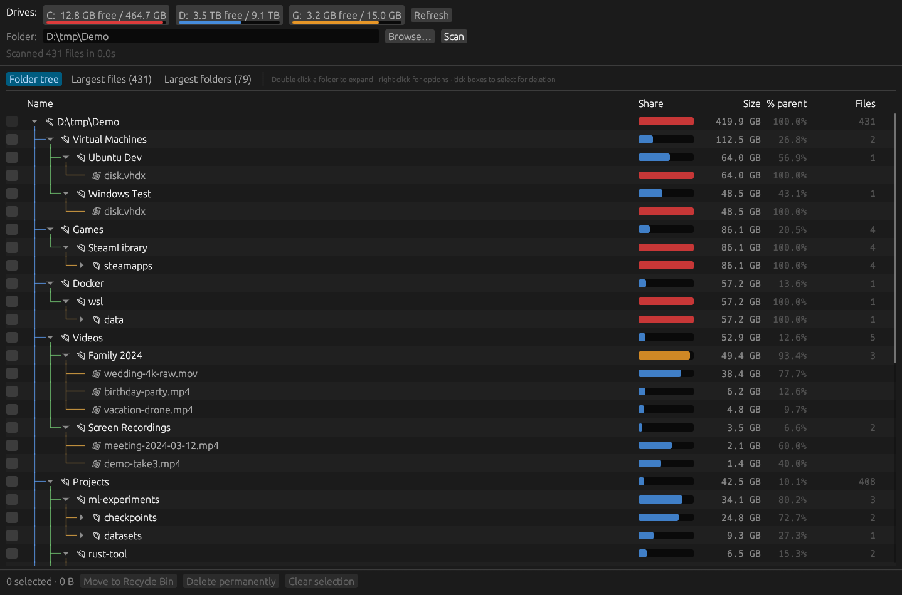
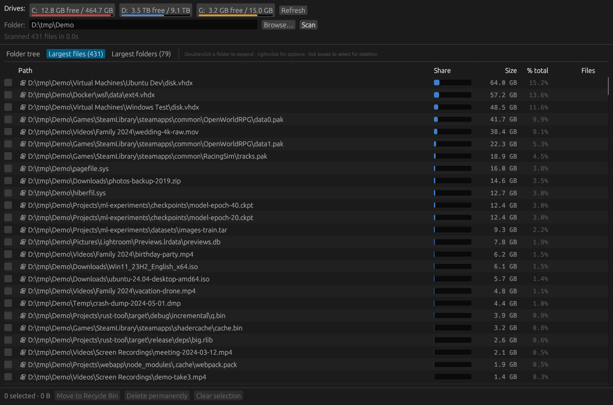

<div align="center">

# 🔭 SpaceScout

### Find what's eating your disk space on Windows in seconds, then delete it.

**A fast, free, open-source disk space analyzer for Windows 10 & 11.**
Scans every core in parallel, shows your biggest folders and files as a drill-down tree,
and lets you clean them up in one click. Single 4 MB `.exe`. No installer, no ads, no telemetry.

[](https://github.com/tamersherif00/SpaceScout/releases/latest)
[](https://github.com/tamersherif00/SpaceScout/releases/latest)
[](LICENSE)
[](https://www.rust-lang.org/)

**[⬇ Download spacescout.exe](https://github.com/tamersherif00/SpaceScout/releases/latest/download/spacescout.exe)** · [Features](#-features) · [How to use](#-how-to-use) · [FAQ](#-faq) · [Build from source](#-build-from-source)



</div>

---

## 😩 The problem

Windows says **"Low disk space"**, and you have no idea why. Explorer won't show folder sizes,
and clicking through hundreds of folders one *Properties* dialog at a time takes forever.

**SpaceScout answers "what is using my disk space?" right away:**

1. Click your drive.
2. See every folder and file **sorted by size, biggest first**.
3. Drill down, tick what you don't need, and **send it to the Recycle Bin**.

That's it. Space reclaimed.

## ⚡ Features

| | |
|---|---|
| 🚀 **Fast multi-threaded scan** | Scans folders in parallel on every CPU core. A real 460 GB system drive with **4.3 million files** scans in **~20 seconds** (warm cache, ~70 s cold) on the author's PC. Small folders finish instantly. |
| 🌳 **Drill-down folder tree** | Everything sorted biggest-first, with colour-coded hierarchy lines so you always know where you are. Each row shows size, **% of its parent folder**, and file count. |
| 🏆 **Largest files & largest folders** | Top 1,000 biggest files and folders across the whole drive in one list. Forgotten ISOs, VM disks, game caches, old backups and `node_modules` jump right out. |
| 🗑️ **Delete right from the results** | Tick files or folders, then choose **Move to Recycle Bin** (undoable) or **Delete permanently**. Sizes update instantly, with no rescan. |
| 🛡️ **Safety built in** | Confirmation dialog listing exactly what will be removed, a clear warning for Windows / Program Files / system files, and the scan root can never be deleted. |
| 💾 **All your drives at a glance** | Every drive with free/total space and a fill bar that turns **orange** above 75% and **red** above 90%. |
| 🪶 **Lightweight & portable** | One ~4 MB executable. No installer, no runtime, no admin required, no background service, nothing written to the registry. |
| 🖱️ **Right-click tools** | Show in Explorer, open folder, copy path, or rescan just one folder. |
| 🔒 **Private** | 100% offline. No accounts, no tracking, no network access. Open source, so you can verify it. |

<div align="center">

<br><sub><i>Largest files view: the biggest space hogs across the whole drive, in one list.</i></sub>
</div>

## 📥 Download & run

1. Download **[spacescout.exe](https://github.com/tamersherif00/SpaceScout/releases/latest/download/spacescout.exe)** from the [latest release](https://github.com/tamersherif00/SpaceScout/releases/latest).
2. Double-click it. No installation needed.

> **Windows SmartScreen** may say *"Windows protected your PC"* because the app isn't code-signed yet.
> Click **More info → Run anyway**. The full source is here if you'd rather [build it yourself](#-build-from-source).

## 🧭 How to use

1. **Pick a drive** at the top (or type/browse to any folder) and the scan starts.
2. The tree opens on the **biggest path automatically**. Expand any folder with the ▸ arrow or a double-click.
3. Switch to **Largest files** or **Largest folders** for a flat top-1000 view. Double-click an entry to jump to it in the tree.
4. **Tick** what you want gone, then press **Move to Recycle Bin** or **Delete permanently**.
5. **Right-click** anything for *Show in Explorer*, *Copy path*, or *Scan only this folder*.

**Tip:** Run as administrator to include folders your account can't read (other user profiles,
`System Volume Information`). SpaceScout tells you how many folders it couldn't access.

## 🔍 What usually eats disk space (and what's safe to remove)

SpaceScout makes these obvious. Here's what they are:

| Usually huge | What it is | Safe to delete? |
|---|---|---|
| `pagefile.sys`, `hiberfil.sys` | Windows virtual memory / hibernation | **Don't delete.** Shrink pagefile in *System → Advanced → Performance*, or run `powercfg /h off` to remove hibernation. |
| `*.vhdx` (WSL, Docker, Hyper-V, Android emulator) | Virtual machine disks | Only via the owning tool (e.g. `wsl --unregister`, Docker *Clean / Purge data*). |
| `Downloads\*.iso, *.zip, *.exe` | Old installers & archives | ✅ Usually yes. |
| `node_modules`, `target`, `.gradle`, `bin/obj` | Developer build output & dependencies | ✅ Yes. They are recreated on the next build/install. |
| Package caches (`uv`, `pip`, `npm`, `NuGet`, `Gradle`) | Downloaded package caches | ✅ Use the tool's clean command (`uv cache clean`, `npm cache clean --force`, …). |
| `AppData\Local\Temp`, crash dumps (`*.dmp`) | Temporary files | ✅ Yes. |
| `C:\Windows\WinSxS`, `Program Files` | Windows components & installed apps | ❌ Use *Settings → Apps* or *Disk Cleanup*, not manual deletion. |

## ❓ FAQ

**Is SpaceScout free?**
Yes, free and open source under the MIT license. No ads, no "pro" version.

**How is it different from WinDirStat, WizTree or TreeSize?**
It's a lightweight, open-source alternative in the same family: a portable single exe written in Rust,
with a parallel scanner, a drill-down tree and top-files lists, and Recycle Bin / permanent delete built in.
If you just want to know *what's taking up space* and remove it, SpaceScout keeps that to one screen.

**Does it work on external drives, USB sticks and network shares?**
Yes. Any drive letter or folder path you can open in Explorer.

**Why does the Windows folder look bigger than expected?**
SpaceScout reports file sizes (not "size on disk"), and NTFS hard links such as those in
`C:\Windows\WinSxS` are counted once per link. Leave Windows folders to *Disk Cleanup*.

**Does it follow symbolic links or junctions?**
No. Symlinks and junctions are skipped, so nothing is counted twice and scans can't loop.

**How much memory does it use?**
Roughly 60–80 bytes per file or folder scanned. A full 4.3-million-file system drive stays around
400 MB while displayed; a typical project or Downloads folder needs only a few dozen MB.

**Is deleting safe?**
*Move to Recycle Bin* is fully undoable. *Delete permanently* asks for confirmation and warns when
system paths are selected. You're always shown exactly what will be removed first.

## 🛠 Build from source

Requires [Rust](https://rustup.rs/) (stable, MSVC toolchain).

```powershell
git clone https://github.com/tamersherif00/SpaceScout.git
cd SpaceScout
cargo build --release          # -> target\release\spacescout.exe
cargo test --release
```

Command line:

```powershell
spacescout.exe "D:\Some Folder"     # open and start scanning a path immediately
spacescout.exe --bench C:\          # headless scan: prints file count, total size, time, top files
```

**How it works:** a work-stealing parallel directory walk ([rayon](https://github.com/rayon-rs/rayon))
over the Win32 directory listing (file sizes come straight from the listing, with no per-file
`stat` call), flattened into a compact 32-byte-per-entry arena with a shared name pool.
The UI is [egui](https://github.com/emilk/egui) and only renders the rows on screen, so even folders with
hundreds of thousands of entries scroll smoothly.

## 🤝 Contributing

Issues and pull requests are welcome! Ideas on the roadmap:

- [ ] Treemap view
- [ ] File-type breakdown (videos, archives, images…)
- [ ] Duplicate file finder
- [ ] Export results to CSV
- [ ] Code-signed releases

If SpaceScout helped you reclaim some space, **please ⭐ star the repo**. It helps others find it.

## 📄 License

[MIT](LICENSE) © Tamer Sherif

---

<sub>Keywords: disk space analyzer · disk usage analyzer · what is taking up space on my C drive · find large files Windows 11 · free up disk space Windows 10 · folder size viewer · WinDirStat alternative · WizTree alternative · TreeSize alternative · SpaceSniffer alternative · storage analyzer · disk cleanup tool · portable · open source</sub>
